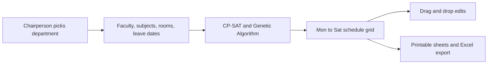

<div align="center">



[](https://git.io/typing-svg)

<br/>


<br/>

[](https://www.arthurr.gt.tc/)
[](https://www.linkedin.com/in/arthur-v-baldosano-jr-2b5607406)
[](mailto:arthurjuniorbaldosano@gmail.com)
[](https://www.upwork.com/freelancers/~01746d5ba8ae90ffb9?mp_source=share)

<br/>


</div>

---

## ⬡ About

Hey, I'm Arthur. Third-year BSIT student at Palawan State University, on the Data Analytics and E-Commerce track, and President of PSU-SITE, the university's IT student org.

I think of myself as a systems and data analyst first. I take a messy requirement, figure out what the system actually needs to do, then build it myself as a full-stack app. Full-stack is how I ship, not what I'm called.

Most of my time right now goes to **ATLAS-PSU**, my thesis project: a teaching load and class scheduling system for PSU's College of Sciences. Outside school I run **[Centrilign](https://github.com/Centrilign)**, a small studio for affiliate and market data products.

**What I like building**
- Tools that fix a real problem for a real office or class
- Full-stack web apps from scratch, with design that doesn't look like a template
- Scheduling, optimization, and data reporting
- Local and API-based AI tools
- Small commerce products I can run and measure myself

---

## ⬡ Right Now

| Status | What |
|--------|------|
| Building | ATLAS-PSU, currently in a big UI/UX overhaul with my thesis group |
| Learning | SQL, Power BI, Excel, and Python for data work, plus statistics |
| Running | PinnedPicks, a Shopee affiliate catalog with its own admin backend |
| Paused | RiseFromNothing and Cruxible, until school calms down |
| Wrapping up | My term as PSU-SITE President and the handover to the next officers |

---

## ⬡ Tech Stack

**Languages**

[](https://skillicons.dev)

**Backend, data, and tooling**

[](https://skillicons.dev)

**Graphics and hosting**

[](https://skillicons.dev)

> Frontends are vanilla HTML, CSS custom properties, and ES6+ JavaScript. No frameworks, no templates.
> Also in the toolbox: Google OR-Tools (CP-SAT), Ollama, Capacitor, Pyodide, Render, GitHub Pages.

---

## ⬡ Analyst and Systems Skills

| Domain | Level | Details |
|--------|-------|---------|
| Systems Analysis and Design | ◆◆◆◆◇ | Requirements, interviews, case studies, and system design for university offices |
| Scheduling and Optimization | ◆◆◆◆◇ | CP-SAT constraint programming and Genetic Algorithms for teaching load assignment |
| Data Analytics | ◆◆◆◇◇ | Dashboards, reporting, and analytics. SQL, Power BI, and Excel are the current grind |
| Full-Stack Development | ◆◆◆◆◇ | Flask, FastAPI, Supabase, PostgreSQL, vanilla JS frontends |
| Affiliate and Commerce Systems | ◆◆◆◆◇ | Live catalog, SEO, Pinterest traffic, and an admin panel that publishes without code |
| LLM Integration | ◆◆◆◇◇ | Ollama local inference, Gemini JSON output, and a Cloudflare Worker chatbot |

---

## ⬡ Featured Projects

> Personal projects live under [**ABaldosano**](https://github.com/ABaldosano). Business products ship under [**Centrilign**](https://github.com/Centrilign).

<details open>
<summary><strong>ATLAS-PSU: Teaching Load Assignment System</strong></summary>

<br/>

My thesis project. A decision-support system that helps department chairpersons at PSU's College of Sciences assign teaching loads and build class schedules, using CP-SAT constraint programming together with a Genetic Algorithm. I built it solo from April to July 2026 and passed the proposal prototype defense. It is now live with real logins and a database, and the final defense is still ahead.

| Attribute | Details |
|-----------|---------|
| Stack | Flask, vanilla JavaScript, OR-Tools CP-SAT, Genetic Algorithm, Supabase (PostgreSQL) |
| Hosting | Render |
| Scope | IT, CS, Marine Biology, Medical Biology, and Environmental Science departments |
| Status | Active development, UI/UX overhaul in progress |
| Live | [atlas-psu.onrender.com](https://atlas-psu.onrender.com) |
| Repository | Private for now |



What makes it different from a generic timetable tool: it is role-based by department, keeps dated saved runs so a chairperson can test schedules without touching the approved one, logs every change, and stores no student data and no passwords of our own.

</details>

<details>
<summary><strong>PinnedPicks: Affiliate Catalog</strong></summary>

<br/>

A curated Shopee product catalog under the Centrilign brand, driven by a Pinterest content strategy. I paste a product link into my admin panel, it converts through the Involve Asia API, grabs the image, and I approve it to go live. No code edits, no redeploys.

| Attribute | Details |
|-----------|---------|
| Stack | HTML, CSS, JavaScript, Supabase |
| Channel | Shopee (Amazon and SHEIN are on hold pending approvals) |
| Traffic | Pinterest, 2.8M+ impressions since June 2026 |
| Extras | Full SEO setup, PWA manifest, cookie consent system |
| Status | Live |
| Repository | [Centrilign/pinnedpicks](https://github.com/Centrilign/pinnedpicks) |
| Site | [www.pinnedpicks.gt.tc](https://www.pinnedpicks.gt.tc/) |

I am honest about the numbers: the traffic is real, the conversions are still tiny. It is a lab for learning how affiliate funnels behave, and the data is the point.

</details>

<details>
<summary><strong>NeuralGrid: Handwriting Recognizer</strong></summary>

<br/>

A handwriting recognizer written from scratch in JavaScript. No ML libraries, just the math. Mercury 0.1 read digits 0 to 9. Mercury 0.2 added uppercase letters A to Z with a mode toggle.

| Attribute | Details |
|-----------|---------|
| Stack | Vanilla JavaScript, Canvas |
| Models | Mercury 0.1 (digits), Mercury 0.2 (digits and letters) |
| Live | [abaldosano.github.io/NeuralGridEngine](https://abaldosano.github.io/NeuralGridEngine/) |

</details>

<details>
<summary><strong>RiseFromNothing and Cruxible: Game and Engine</strong></summary>

<br/>

RiseFromNothing is a 3D idle city-builder on Three.js where you climb a job ladder from Beggar upward and grow a network of businesses. Cruxible is the engine under it, with a map editor that has undo/redo, radial symmetry, copy/paste, and drag-to-delete, plus Capacitor builds for Android. Both sit in the Centrilign software and game assets stream.

| Attribute | Details |
|-----------|---------|
| Stack | JavaScript (ES Modules), Three.js, Capacitor |
| Features | NPC pathfinding, day-night cycle, real estate system, business panels, modular codebase |
| Status | Paused while acads take over |
| Repository | [ABaldosano/RiseFromNothing](https://github.com/ABaldosano/RiseFromNothing) |
| Demo | [abaldosano.github.io/RiseFromNothing](https://abaldosano.github.io/RiseFromNothing/) |

</details>

<details>
<summary><strong>PSU_AcadRes: AI Academic Resource Platform</strong></summary>

<br/>

Upload a document and get summaries, flashcards, quizzes, glossary terms, and key concepts back. Built with FastAPI and local Ollama inference, with role-based access. Title proposal defended. Grew out of Buzy-Reviewer.

| Attribute | Details |
|-----------|---------|
| Stack | JavaScript, Python, FastAPI, Ollama (Llama3), RBAC |
| Status | Live prototype |
| Repository | [ABaldosano/PSU_AcadRes](https://github.com/ABaldosano/PSU_AcadRes) |
| Demo | [abaldosano.github.io/PSU_AcadRes](https://abaldosano.github.io/PSU_AcadRes/) |

</details>

<details>
<summary><strong>Portfolio Site: arthurr.gt.tc</strong></summary>

<br/>

Hand-built portfolio with no frameworks. It has a Cloudflare Worker chatbot (Gemini JSON output, KV rate limiting, prompt-leak detection), an in-browser Python IDE running on Pyodide, dark and light mode, and a full SEO setup across six pages: Person, FAQPage, ItemList, and ScholarlyArticle schemas, hreflang, and Dublin Core metadata.

| Attribute | Details |
|-----------|---------|
| Stack | HTML5, CSS3, Vanilla JS, Cloudflare Workers, Pyodide |
| Site | [www.arthurr.gt.tc](https://www.arthurr.gt.tc/) |
| Repository | [ABaldosano/My_Portfolio](https://github.com/ABaldosano/My_Portfolio) |

</details>

<details>
<summary><strong>CrypStockDash: Market Data Viewer</strong></summary>

<br/>

Search any stock or crypto ticker and get live data. No account, no login.

| Attribute | Details |
|-----------|---------|
| Stack | HTML, CSS, JavaScript, Finance API |
| Repository | [Centrilign/crypstockdash](https://github.com/Centrilign/crypstockdash) |
| Site | [www.crypstockdash.page.gd](https://www.crypstockdash.page.gd/) |

</details>

<details>
<summary><strong>Smaller builds and earlier work</strong></summary>

<br/>

| Project | What it is |
|---------|------------|
| [PostgreSQL CRUD Dashboard](https://github.com/ABaldosano) | Full CRUD app with parameterized queries, server-side validation, and a profanity filter. Railway and Supabase |
| [ProductSortGame](https://github.com/ABaldosano/ProductSortGame) | Falling-item sorting game. Started as a C# WinForms DSA finals project, then ported to the web. [Play](https://abaldosano.github.io/ProductSortGame/) |
| [Updated-Faculty-Workload-Balancing-System](https://github.com/ABaldosano/Updated-Faculty-Workload-Balancing-System) | The early workload balancer that ATLAS-PSU grew out of |
| [Buzy-Reviewer](https://github.com/ABaldosano/Buzy-Reviewer) | Interactive study tool. Direct ancestor of PSU_AcadRes. [Demo](https://abaldosano.github.io/Buzy-Reviewer/index.html) |
| [Cyberpunk2077](https://github.com/ABaldosano/Cyberpunk2077) | Night City neon UI experiment. [View](https://abaldosano.github.io/Cyberpunk2077/) |
| [deathstranding](https://github.com/ABaldosano/deathstranding) | Atmospheric UI experiment. [View](https://abaldosano.github.io/deathstranding/) |
| [productdiscoveryformat1](https://github.com/ABaldosano/productdiscoveryformat1) and [2](https://github.com/ABaldosano/productdiscoveryformat2) | Two commissioned product discovery layouts. [Format 1](https://abaldosano.github.io/productdiscoveryformat1/), [Format 2](https://abaldosano.github.io/productdiscoveryformat2/) |

</details>

---

## ⬡ Experience

**President** · Society of Information Technology Enthusiasts (PSU-SITE)
`Aug 2024 to 2026`

Led PSU's IT student org through events, general assemblies, officer elections, constitution amendments, and a full audit cycle. Now in the handover stretch with the incoming officers.

- Organized seminars, workshops, and inter-collegiate events
- Represented BSIT students in school and org settings
- Handled the org's finances and audit paperwork, and got the A.Y. 2025-26 audit opinion fixed


---

**Founder** · Centrilign
`2026 to Present`

A small studio that ships affiliate platforms, market data tools, and game assets. I do the analysis, the design, the build, the deploy, and the traffic.

- PinnedPicks: live Shopee affiliate catalog with a no-code admin panel
- CrypStockDash: no-login market viewer
- Cruxible and RiseFromNothing: game engine and its first game


---

## ⬡ Achievements

<div align="center">

| What | Details |
|------|---------|
| PSU-SITE President | Elected to lead PSU's IT student org |
| ATLAS-PSU | Built solo, passed the proposal prototype defense, now live with a real database |
| Live products | PinnedPicks, CrypStockDash, ATLAS-PSU, PSU_AcadRes, and my portfolio are all running |
| Research | Position paper on AI literacy published on Zenodo |
| Contributions | 748 GitHub contributions in the last year |
| Certifications | 16 on my portfolio across AI, data analytics, and marketing |

</div>

---

## ⬡ Research

**Published on Zenodo**

- **AI Literacy in Philippine Higher Education**: a position paper on how AI literacy is, and is not, being handled across Philippine higher education. It got a serious critique on LinkedIn from an Ateneo BUILD director, which I answered.

**In the drafts folder**

- A second position paper applying Abraham Wald's survivorship bias idea to AI-generated content detection. On hold for now.


---

## ⬡ Certifications


-6d28d9?style=flat-square)

> Next on the list: one more data analytics cert, and PMI's CAPM right after graduation.

---

## ⬡ Current Focus

```yaml
current_focus:
  building:
    - ATLAS-PSU UI/UX overhaul (sidebar nav, drag and drop grid, printable sheets)
    - Centrilign product pipeline
  learning:
    - SQL, Power BI, Excel, Python for data analysis
    - Statistics
  paused:
    - RiseFromNothing and Cruxible
  how_i_work:
    - Analyze first, design the system, then write code
    - Build from scratch, skip the template
    - Keep handoffs in files so the work survives any session
    - Own the whole loop, from idea to deployed
```

---

## ⬡ Connect

<div align="center">

[](mailto:arthurjuniorbaldosano@gmail.com)
[](https://www.linkedin.com/in/arthur-v-baldosano-jr-2b5607406)
[](https://github.com/ABaldosano)
[](https://www.arthurr.gt.tc/)
[](https://github.com/Centrilign)

</div>

---

<div align="center">

*Building from Puerto Princesa. Shipping things that work.*

</div>
